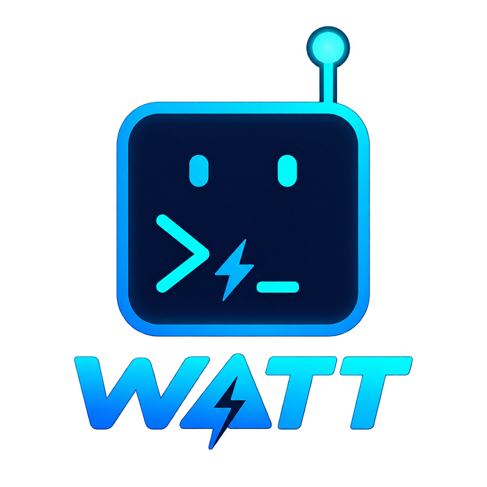
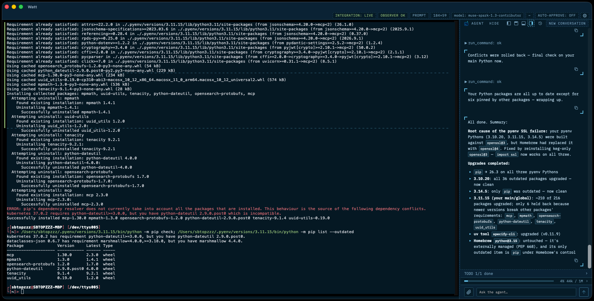

<p align="center">
  
</p>

# Watt Terminal

*Whatever Agentic Terminal Thing.*

[](https://github.com/SBTopZZZ-LG/watt-terminal/actions/workflows/ci.yml) [](LICENSE)

An experimental terminal for macOS and Windows 11 where you and an AI agent share one persistent shell session. You type commands as you always do. The agent sees the same session (commands, output, screen, working directory) and can run commands in it, with your approval. Built with Tauri v2, Rust, React and TypeScript, with xterm.js for rendering.

<p align="center">
  
</p>

> Experimental and still changing. Behaviour and settings may change between versions. It has not been fully tested yet, notably on Windows, so expect rough edges. Targets macOS and Windows 11.

## What it does

- **One shared shell.** A real `zsh -l` session on macOS, or PowerShell on Windows, started through an integration shim. Your own dotfiles are read, never edited. The agent reads the same command history, output and screen you do.
- **Agent with guard rails.** Read tools are always allowed. `run_command` needs your approval unless a rule or the session's bypass toggle allows it, and only runs at an idle prompt with shell integration live. `send_keys` can type into a command the agent started, and password prompts are refused. Secrets in tool output are redacted before they reach the model.
- **Bring your own model.** Any OpenAI-compatible chat endpoint. Presets for OpenRouter and OpenCode Go, plus a custom endpoint. API keys live in the macOS Keychain or the Windows Credential Manager, not in the settings file.
- **Context meter.** A live estimate of how much of the model's context window is used, broken down by system instructions, tools, your messages, attachments, assistant replies and tool output. When the window fills, the oldest tool output, document text and whole turns are trimmed from what is sent, newest first kept; your stored conversation is never rewritten.
- **Attachments.** Drop or paste images and text files onto the agent bar.
- **Todo panel.** The agent keeps a todo list for multi-step work, pinned above the context meter.
- **Reasoning.** The model's reasoning streams into a block in the agent panel, with a loader at the bottom while the agent works. Settings, Terminal, Reasoning sets it to collapsed, auto (open while thinking) or expanded. Reasoning is not kept after a reload.
- **Redo on exit.** If a command the agent is working with exits while the agent is replying, the unsent reply is dropped and the agent is asked again, knowing the command finished (at most three redos a turn).
- **Conversations are saved.** Browse past conversations in the history view and pick one back up.
- **Terminal comforts.** Find (Cmd+F for the chat or the terminal, Cmd+Shift+F for the terminal), clear (Cmd+K), font zoom, a colour stripe per command showing its exit status, and a border that pulses while the agent works.

## Getting started

Prerequisites: macOS with the Xcode command line tools, or Windows 11; Rust 1.90 or newer; Node.js 22.12 or newer; and zsh on macOS (on Windows the shell is PowerShell, see [Build and install on Windows](#build-and-install-on-windows)).

```sh
npm install
npm run tauri dev
```

To keep manual runs away from your real `~/.zsh_history`, point the shell at another file with `WATT_HISTFILE`:

```sh
WATT_HISTFILE=/tmp/watt-terminal-hist npm run tauri dev
```

### Connect a model

Open Settings (Cmd+,), go to **Models**, pick a preset or add a custom OpenAI-compatible endpoint, and paste your API key. With no model saved (and no `WATT_LLM_*` variables set) the app uses a mock agent with a few keyword rules and no network, which is enough to try the UI. A saved default model that cannot be used shows an error rather than falling back.

The default model has an optional variant: a named preset of extra request settings for that model (for example a reasoning effort). Pick it in the **Variant** select next to the model, or with `/model provider/model#variant`. The variants in the list come from the provider's model list when it is fetched; the status strip shows the saved one as `model: id#variant`. With no variant the base model runs with the provider defaults.

To set your own variant, open the provider and expand **Variants (N)** under the model: give it an id, a label and a JSON object body such as `{"reasoning":{"effort":"high"}}`, then save and pick it as the default variant. Manual variants are kept across fetches and win over a fetched variant with the same id; the default variant cannot be removed while it is selected. A manual variant can set `max_completion_tokens` for providers that reject `max_tokens`.

For development you can skip the settings dialog and set all three of these (read the key from a password manager rather than typing it into your shell history):

```sh
WATT_LLM_URL=https://openrouter.ai/api/v1/chat/completions \
WATT_LLM_MODEL=<model id> \
WATT_LLM_KEY="$(your-password-manager get openrouter)" \
npm run tauri dev
```

These are only used when no default model is saved. Optional: `WATT_LLM_HEADERS` (`Name: value` lines, or separated by `;`; `{session_id}` is replaced by the conversation id), `WATT_LLM_STREAM=0` (wait for each whole reply), `WATT_LLM_MAX_TOKENS`.

## Using it

The terminal is the main input: keys go to the shell, or to whatever program is running. The bar under the transcript is for the agent: its text is a message to the agent, never shell input, unless it is a slash command (see below). A `run` request shows an approval card before anything is typed into your shell.

| Keys | Action |
| --- | --- |
| Ctrl/Cmd+Shift+A | Focus the agent bar (Esc returns to the terminal) |
| Enter in the bar | Send; with an empty bar and a pending approval, approve it |
| Esc in the bar | Deny the first pending approval; with none, return to the terminal |
| Ctrl+C in the bar | Interrupt the agent's turn and the running command |
| Cmd+, | Settings |
| Cmd+F | Find in the chat when focus is in the agent panel, else in the terminal (Enter / Shift+Enter step, Esc closes) |
| Cmd+Shift+F | Find in the terminal |
| Cmd+K | Clear scrollback (not in full-screen apps) |
| Cmd+Plus / Minus / 0 | Font size up / down / reset (saved between launches) |
| Option+Left/Right, Cmd+Left/Right, Cmd+Backspace | Word jump, line start/end, clear line |
| Shift+Enter | Newline (Ctrl+J) in a running program such as `claude`; a plain Enter at the prompt |

The table shows macOS keys. On Windows the in-app hints show Ctrl instead of Cmd (for example Ctrl+Shift+A and Ctrl+,).

The agent panel docks left or right.

### Slash commands

The bar also takes slash commands. Local actions: `/help` (list commands), `/new` (new conversation, `/clear` too), `/stop` (stop the running turn), `/model` (open Settings, or `/model provider/model` to switch), `/export` (copy the conversation as Markdown), `/context` (show the context usage of the last model request), `/history` (open the History view), `/rename <title>` (rename the current conversation), `/btw <question>` (ask a side question about the conversation; the answer is shown once and never stored), `/compact` (summarize the conversation into a new one; the old one stays in history), `/fork` (copy the conversation into a new one and switch to it). Templates sent as a normal message: `/plan [task]`, `/review [focus]` and `/init [focus]` (inspect the project, then create or update `AGENTS.md` at the workspace root). Custom commands are Markdown files in `<workspace root>/.watt/commands` (project) or `<config dir>/commands` (global): the file stem is the name, an optional `---` frontmatter block holds `description:` and `argument-hint:`, and the body is the template with `$ARGUMENTS` and `$1`..`$9`. Built-ins win over customs; any other `/text` is sent to the agent unchanged. Commands never run shell. The workspace root's `AGENTS.md`, when present, is also loaded as project instructions at the start of each agent turn.

Typing `/` opens an autocomplete menu: ArrowUp/Down moves, Enter or Tab accepts, Esc dismisses. Enter on a fully typed command runs it; Enter/Tab on a partial name completes it. `/help` shows the list in a dialog (Esc or the backdrop closes it, focus returns to the bar) instead of the transcript. Bare `/model` opens Settings with the default-model select focused, so Space opens its list. `/history` opens the History view with its search field focused.

## Approvals

Approval mode is set in Settings, under **Approvals**. **Manual** (the default) asks before every `run_command` and the first `send_keys` into a command. **Regex rules** lets you allow or deny commands by pattern, with a built-in deny list and a cap on automatic approvals per turn. **Bypass** is a separate, session-only switch that resets when the app restarts. While it is on, the approval chip above the input turns orange and its tooltip says so. Under **When I deny a call**, **Keep working** (the default) lets the agent try another way after a denied call, and **Stop** ends the turn.

## Configuration and data

On macOS, settings, UI state, window state and conversations live in `~/Library/Application Support/dev.watt.terminal`, and API keys are in the Keychain (service `dev.watt.terminal`, account `secrets`; a large set is split across items `secrets.1`, `secrets.2`, and so on). On Windows your data is in `%APPDATA%\dev.watt.terminal` and `%LOCALAPPDATA%\dev.watt.terminal`, and API keys are in Windows Credential Manager. Overrides for development and tests:

| Variable | Effect |
| --- | --- |
| `WATT_CONFIG_DIR`, `WATT_DATA_DIR` | Use other folders for settings and for conversations |
| `WATT_SECRETS_FILE` | Store keys in a 0600 file instead of the Keychain |
| `WATT_HISTFILE` | `HISTFILE` for the shell |
| `WATT_PROMPT_GAP=0` | Turn off the blank row before each prompt (the separator line then sits on the prompt's top edge) |

The older `AGENT_TERM_*` names still work when the matching `WATT_*` name is not set.

## Build and install on macOS

```sh
npm run app:build                # release build of Watt.app, after the type check and tests
npm run app:install              # copy it to /Applications (or ~/Applications)
npm run app:release -- --open    # build, install, then launch
```

Both scripts take `--help`. Useful flags: `app:build --dmg` also makes a DMG, `--debug` builds the debug profile, `--no-checks` skips `tsc` and `vitest`, `--full` also runs `cargo clippy` and `cargo test`; `app:install --dest DIR`, `--force`, `--dry-run`, `--uninstall`. Set `SIGN_IDENTITY` to sign with a named identity instead of ad hoc. The build lands in `src-tauri/target/release/bundle/macos/Watt.app`.

The app is ad-hoc signed and not notarised, which is fine on the Mac that built it. A copy on another Mac is blocked by Gatekeeper: right-click and choose Open, or run `xattr -dr com.apple.quarantine /Applications/Watt.app`.

Before each install replaces the app, the old copy is kept in `~/Library/Caches/watt-terminal/previous/` (the two newest): quit Watt and copy one over the installed app to roll back. Install and uninstall never touch your data or Keychain items. The scripts are tested with fake bundles: `bash scripts/test-app-scripts.sh`.

## Build and install on Windows

Prerequisites: Windows, Node.js, Rust (rustup), and `npm ci` run once. The first build downloads NSIS into `%LOCALAPPDATA%\tauri`, which needs internet.

```powershell
npm run app:build:win          # NSIS installer: src-tauri\target\release\bundle\nsis\Watt_<version>_x64-setup.exe
npm run app:install:win        # build if the installer is missing or older than the sources, install silently, verify
npm run app:uninstall:win      # uninstall silently, verify
```

The install is per user, with no elevation (no admin prompt): files go to `%LOCALAPPDATA%\Watt`, and Watt is listed under Installed apps. A silent install (what the script runs) creates a Start Menu shortcut and a Desktop shortcut. The install script takes `-Rebuild`, `-CloseRunning` (stops a running Watt; without it the script stops and asks you to close Watt) and `-InstallerPath <exe>`. Uninstall removes the app folder, the shortcuts and the Installed apps entry. Your data in `%APPDATA%\dev.watt.terminal` and `%LOCALAPPDATA%\dev.watt.terminal` is kept.

The installer is not code signed, so SmartScreen shows an "unknown publisher" warning: choose More info, then Run anyway. The WebView2 runtime is needed; the installer downloads it only if it is missing, which needs internet. The scripts run PowerShell with `-ExecutionPolicy Bypass` for that process only.

## Tests

```sh
npm test && npx tsc --noEmit && npm run build   # frontend
cd src-tauri && cargo test                      # backend
```

The Rust integration tests spawn real `zsh -l` sessions through your own startup files (`~/.zshenv`, `~/.zprofile`, `~/.zshrc`, `~/.zlogin`), one at a time, with a temporary `HISTFILE`. Expect them to take a few minutes. The SSH end-to-end tests need Docker and are ignored by default. On Windows, `src-tauri/tests/windows_*.rs` run PowerShell sessions instead.

`npm run test:all` runs the frontend checks and `cargo clippy` and `cargo test` on your machine, prints a pass/fail summary, and exits non-zero if any step failed. `npm run test:all -- --docker` also runs clippy and the Rust tests in `ci/linux/Dockerfile` (Debian bookworm, zsh 5.9), using the named volumes `watt-ci-cargo` and `watt-ci-target`. `--only=<step,...>` runs a subset (`tsc`, `test`, `build`, `clippy`, `cargo-test`, `docker-build`, `docker-test`).

CI (`.github/workflows/ci.yml`) runs the frontend checks and the Rust clippy and tests on macOS, Windows and Ubuntu, plus the Docker Linux run. Platform UI (the WebView, native menu, installers, Keychain) is not covered by CI and stays manual.

## Known limitations

- The local shell is `zsh -l` on macOS. On Windows it is PowerShell: `pwsh.exe` from the first absolute PATH entry that has it, else Windows PowerShell (`powershell.exe` under `%SystemRoot%`).
- Windows ConPTY: resizing the window while a lot of output is on screen can misalign the command stripes, agent labels and records. ConPTY repaints only the visible rows and xterm reflows them differently. Running `clear` resets the marks. This is an upstream ConPTY/xterm limit and is not fixed.
- Text from before a `clear` is not part of a later command's record.
- Nested shells and ssh sessions are integrated on request (the agent asks first). An `exec zsh` or a nested shell that was never integrated silently loses shell integration, and the app does not detect that yet.
- Full-screen apps (vim, less) are rendered and the agent can read their screen, but it can type only into commands it started itself.
- Images are sent to the model unless it has already refused them in the conversation; the UI warns when a model is not marked vision-capable. Documents must be UTF-8 text.
- The macOS app is not notarised, and the Windows installer is not code signed (see above).

## Upgrading from the old identifier

The app used to be called `dev.agentterm.app`. On first launch under `dev.watt.terminal` the old data folder and the saved API keys are copied, not moved; nothing is deleted. Quit the old app first. Once you are happy, you can remove the old copies:

```sh
security delete-generic-password -s dev.agentterm.app
rm -r "$HOME/Library/Application Support/dev.agentterm.app"
```

## Contributing

Issues and pull requests are welcome. `AGENTS.md` describes the layout, the invariants worth protecting and the checks to run; it is written for coding agents but reads fine for people.

## License

MIT, see [LICENSE](LICENSE). The logo is AI-generated, and the app icons and image assets are derived from it. The IBM Plex Mono font comes from the `@fontsource/ibm-plex-mono` package (SIL Open Font License 1.1).
