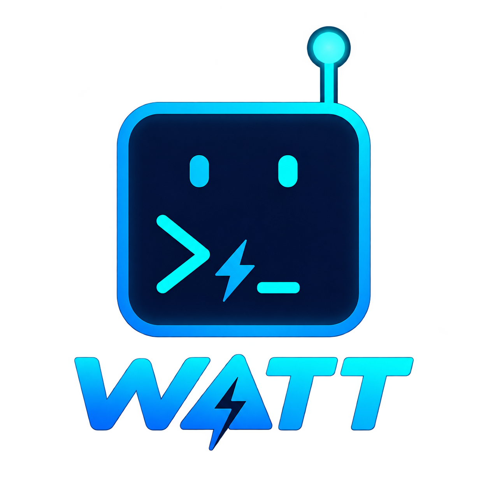

<p align="center">
  
</p>

# Watt Terminal

Whatever Agentic Terminal Thing

A terminal where you and an AI agent share one persistent shell session. You run commands in the terminal as usual; the agent can see the same session (commands, output, screen, cwd) and can run commands in it. Built with Tauri v2, Rust, React and TypeScript, with xterm.js for rendering.

## Slice 1 scope

- Local `zsh -l` only, started through an integration shim. The user's own dotfiles are read and never edited.
- The agent is a mock (`MockAgent`): deterministic keyword rules, no network, no API key.
- Read tools are always allowed. `run_command` needs approval each time unless the session's auto-approve toggle is on (off by default). It only runs at an idle prompt with shell integration live.
- `send_keys` is a stub that returns an error.

## Prerequisites

- macOS
- Rust (with `cargo`)
- Node.js and npm
- zsh (the default macOS shell)

## Setup and running

```sh
npm install
npm run tauri dev
```

To keep manual runs away from your real `~/.zsh_history`, use the isolated-history variant. `WATT_HISTFILE` is a dev-only setting. When it is set, the shell's `HISTFILE` is that path. When it is unset, which is the default, the shell uses your own history file.

```sh
WATT_HISTFILE=/tmp/watt-terminal-hist npm run tauri dev
```

The shell leaves a blank row before each prompt that follows a command, and a thin separator line sits in that row. `WATT_PROMPT_GAP=0` turns the blank row off, in which case the line sits on the prompt's top edge.

To try a real model instead of the mock agent, set three variables. Keep the key out of your shell history: read it from your password manager (`NAME` is the name of your entry):

```sh
WATT_LLM_URL=https://openrouter.ai/api/v1/chat/completions \
WATT_LLM_MODEL=deepseek/deepseek-v4.1-flash \
WATT_LLM_KEY="$(gopass show -o NAME)" \
npm run tauri dev
```

Optional: `WATT_LLM_HEADERS` (`Name: value` lines, or separated by `;`; `{session_id}` is replaced by the conversation id, for example `x-opencode-session: {session_id}` for OpenCode Go), `WATT_LLM_STREAM=0` (wait for each whole reply instead of streaming), and `WATT_LLM_MAX_TOKENS` (a positive number). When URL, key or model is missing, the mock agent is used. A bad value is printed to the terminal at launch and the mock agent is used. These variables are for development only; they will move to a settings file.

The older `AGENT_TERM_*` names (for example `AGENT_TERM_LLM_URL`) still work when the matching `WATT_*` name is not set.

## Input

- The terminal is the main input. Type at the prompt as you would in any terminal. Keys go to the shell, or to the program that is running (vim, ssh, and so on).
- Mapped keys: Option+Left/Right move by word, Cmd+Left/Right go to the line start/end, and Cmd+Backspace clears the line (none of these in full-screen apps). Shift+Enter sends a newline (Ctrl+J) to a running program or full-screen app such as claude; at the prompt it stays a plain Enter. Cmd+Backspace sends Ctrl-U, which also marks the typed prompt as edited, so if the agent then refuses to run a command, press Ctrl+C in the terminal.
- Cmd+F finds text in the terminal (Enter and Shift+Enter step through matches, Esc closes). Cmd+K clears the scrollback and redraws the prompt at the top (it does nothing in full-screen apps). Cmd+Plus, Cmd+Minus and Cmd+0 change the font size, which is saved between launches.
- The bar at the bottom is for the agent. Its text is always a message to the agent, including text that starts with `!`. For example, "what was the last command" or "run `pwd`". A `run` request shows an approval card before anything is typed into the shell.
- Ctrl+Shift+A focuses the agent bar. Esc in the bar returns focus to the terminal.
- While the agent runs an approved command, a green border pulses around the terminal. It fades out when the agent is idle.

## Tests

Frontend:

```sh
npm test
npm run build
```

Backend:

```sh
cd src-tauri && cargo test
```

The Rust integration tests spawn real `zsh -l` sessions through the user's own startup files (`~/.zshenv`, `~/.zprofile`, `~/.zshrc`, `~/.zlogin`). They run with a temporary `HISTFILE` so the real `~/.zsh_history` is not written. Expect them to take about a minute, since they run one at a time.

## Known limitations

- Mock agent only. There is no LLM yet.
- Local zsh only. No SSH.
- No "integration lost" detection. An `exec zsh` or nested shell silently loses shell integration.
- TUIs (alternate-screen apps such as `vim` or `less`) are rendered, but the agent can only read the screen. It cannot type into them, because `send_keys` is a stub.
- Conversation is not persisted across app restarts.

## Notes

Dropping a file on the terminal does nothing, as it did before: the app never inserted a dropped file's path. The native file drop is off (`dragDropEnabled: false` in `src-tauri/tauri.conf.json`), so the webview receives the drag and can take it. A file dropped on the agent's input bar is attached to the message; a drop anywhere else is cancelled (see `src/lib/dropGuard.ts`).

The bundle identifier is `dev.watt.terminal` (`src-tauri/tauri.conf.json`). It names the app's data folder and the Keychain item for API keys. The app used to be called `dev.agentterm.app`. On the first launch under the new identifier, the old data is copied, not moved:

- The old folder `~/Library/Application Support/dev.agentterm.app/` (settings, UI state, window state, conversations) is copied to `~/Library/Application Support/dev.watt.terminal/`. The copy is skipped when the new folder already has content.
- The saved API keys are copied from the old Keychain item (service `dev.agentterm.app`, account `secrets`) to a new one (service `dev.watt.terminal`). macOS may ask once for permission to read the old item.

Nothing is deleted. Once you are happy with the new app, you can remove the old copies yourself:

```sh
security delete-generic-password -s dev.agentterm.app
rm -r "$HOME/Library/Application Support/dev.agentterm.app"
```

Quit the old app before the first launch under the new name. A running old instance keeps using its own folder and its own single-instance socket, so the two apps do not see each other, and changes it makes later are not copied over. The `WATT_CONFIG_DIR` and `WATT_DATA_DIR` overrides skip the folder copy.
