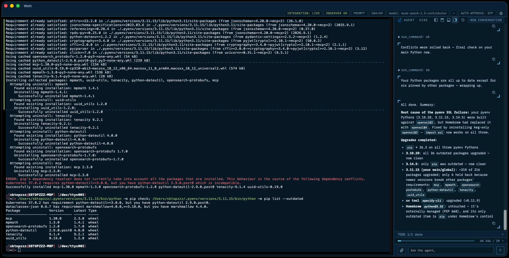

<p align="center">
  
</p>

# Watt Terminal

*Whatever Agentic Terminal Thing.*

[](https://github.com/SBTopZZZ-LG/watt-terminal/actions/workflows/ci.yml) [](LICENSE)

A macOS terminal where you and an AI agent share one persistent shell session. You type commands as you always do. The agent sees the same session (commands, output, screen, working directory) and can run commands in it, with your approval. Built with Tauri v2, Rust, React and TypeScript, with xterm.js for rendering.

<p align="center">
  
</p>

> Early-stage personal project. It works day to day for its author, but expect rough edges. macOS only.

## What it does

- **One shared shell.** A real `zsh -l` session, started through an integration shim. Your own dotfiles are read, never edited. The agent reads the same command history, output and screen you do.
- **Agent with guard rails.** Read tools are always allowed. `run_command` needs your approval unless a rule or the session's auto-approve toggle allows it, and only runs at an idle prompt with shell integration live. `send_keys` can type into a command the agent started, and password prompts are refused. Secrets in tool output are redacted before they reach the model.
- **Bring your own model.** Any OpenAI-compatible chat endpoint. Presets for OpenRouter and OpenCode Go, plus a custom endpoint. API keys live in the macOS Keychain, not in the settings file.
- **Context meter.** A live estimate of how much of the model's context window is used, broken down by system instructions, tools, your messages, attachments, assistant replies and tool output. When the window fills, the oldest tool output, document text and whole turns are trimmed from what is sent, newest first kept; your stored conversation is never rewritten.
- **Attachments.** Drop or paste images and text files onto the agent bar.
- **Todo panel.** The agent keeps a todo list for multi-step work, pinned above the context meter.
- **Conversations are saved.** Browse past conversations in the history view and pick one back up.
- **Terminal comforts.** Find (Cmd+F), clear (Cmd+K), font zoom, a colour stripe per command showing its exit status, and a border that pulses while the agent works.

## Getting started

Prerequisites: macOS, the Xcode command line tools, Rust 1.90 or newer, Node.js 22.12 or newer, and zsh.

```sh
npm install
npm run tauri dev
```

To keep manual runs away from your real `~/.zsh_history`, point the shell at another file with `WATT_HISTFILE`:

```sh
WATT_HISTFILE=/tmp/watt-terminal-hist npm run tauri dev
```

### Connect a model

Open Settings (Cmd+,), go to **Models**, pick a preset or add a custom OpenAI-compatible endpoint, and paste your API key. With no model saved (and no `WATT_LLM_*` variables set) the app uses a mock agent with a few keyword rules and no network, which is enough to try the UI. A saved default model that cannot be used shows an error rather than falling back.

For development you can skip the settings dialog and set all three of these (read the key from a password manager rather than typing it into your shell history):

```sh
WATT_LLM_URL=https://openrouter.ai/api/v1/chat/completions \
WATT_LLM_MODEL=<model id> \
WATT_LLM_KEY="$(your-password-manager get openrouter)" \
npm run tauri dev
```

These are only used when no default model is saved. Optional: `WATT_LLM_HEADERS` (`Name: value` lines, or separated by `;`; `{session_id}` is replaced by the conversation id), `WATT_LLM_STREAM=0` (wait for each whole reply), `WATT_LLM_MAX_TOKENS`.

## Using it

The terminal is the main input: keys go to the shell, or to whatever program is running. The bar under the transcript is for the agent: its text is always a message to the agent, never shell input. A `run` request shows an approval card before anything is typed into your shell.

| Keys | Action |
| --- | --- |
| Ctrl/Cmd+Shift+A | Focus the agent bar (Esc returns to the terminal) |
| Enter in the bar | Send; with an empty bar and a pending approval, approve it |
| Esc in the bar | Deny the first pending approval; with none, return to the terminal |
| Ctrl+C in the bar | Interrupt the agent's turn and the running command |
| Cmd+, | Settings |
| Cmd+F | Find in the terminal (Enter / Shift+Enter step, Esc closes) |
| Cmd+K | Clear scrollback (not in full-screen apps) |
| Cmd+Plus / Minus / 0 | Font size up / down / reset (saved between launches) |
| Option+Left/Right, Cmd+Left/Right, Cmd+Backspace | Word jump, line start/end, clear line |
| Shift+Enter | Newline (Ctrl+J) in a running program such as `claude`; a plain Enter at the prompt |

The agent panel docks left, right, top or bottom.

## Approvals

Approval mode is set in Settings, under **Approvals**. **Manual** (the default) asks before every `run_command` and the first `send_keys` into a command. **Regex rules** lets you allow or deny commands by pattern, with a built-in deny list and a cap on automatic approvals per turn. Auto-approve is a separate, session-only switch that resets when the app restarts and shows a banner while on.

## Configuration and data

Settings, UI state, window state and conversations live in `~/Library/Application Support/dev.watt.terminal`. API keys are in one Keychain item (service `dev.watt.terminal`, account `secrets`). Overrides for development and tests:

| Variable | Effect |
| --- | --- |
| `WATT_CONFIG_DIR`, `WATT_DATA_DIR` | Use other folders for settings and for conversations |
| `WATT_SECRETS_FILE` | Store keys in a 0600 file instead of the Keychain |
| `WATT_HISTFILE` | `HISTFILE` for the shell |
| `WATT_PROMPT_GAP=0` | Turn off the blank row before each prompt (the separator line then sits on the prompt's top edge) |

The older `AGENT_TERM_*` names still work when the matching `WATT_*` name is not set.

## Build and install the app

```sh
npm run app:build                # release build of Watt.app, after the type check and tests
npm run app:install              # copy it to /Applications (or ~/Applications)
npm run app:release -- --open    # build, install, then launch
```

Both scripts take `--help`. Useful flags: `app:build --dmg` also makes a DMG, `--debug` builds the debug profile, `--no-checks` skips `tsc` and `vitest`, `--full` also runs `cargo clippy` and `cargo test`; `app:install --dest DIR`, `--force`, `--dry-run`, `--uninstall`. Set `SIGN_IDENTITY` to sign with a named identity instead of ad hoc. The build lands in `src-tauri/target/release/bundle/macos/Watt.app`.

The app is ad-hoc signed and not notarised, which is fine on the Mac that built it. A copy on another Mac is blocked by Gatekeeper: right-click and choose Open, or run `xattr -dr com.apple.quarantine /Applications/Watt.app`.

Before each install replaces the app, the old copy is kept in `~/Library/Caches/watt-terminal/previous/` (the two newest): quit Watt and copy one over the installed app to roll back. Install and uninstall never touch your data or Keychain items. The scripts are tested with fake bundles: `bash scripts/test-app-scripts.sh`.

## Tests

```sh
npm test && npx tsc --noEmit && npm run build   # frontend
cd src-tauri && cargo test                      # backend
```

The Rust integration tests spawn real `zsh -l` sessions through your own startup files (`~/.zshenv`, `~/.zprofile`, `~/.zshrc`, `~/.zlogin`), one at a time, with a temporary `HISTFILE`. Expect them to take a few minutes. The SSH end-to-end tests need Docker and are ignored by default.

## Known limitations

- macOS only. The local shell is always `zsh -l`.
- Nested shells and ssh sessions are integrated on request (the agent asks first). An `exec zsh` or a nested shell that was never integrated silently loses shell integration, and the app does not detect that yet.
- Full-screen apps (vim, less) are rendered and the agent can read their screen, but it can type only into commands it started itself.
- Images are sent to the model unless it has already refused them in the conversation; the UI warns when a model is not marked vision-capable. Documents must be UTF-8 text.
- Not notarised (see above).

## Upgrading from the old identifier

The app used to be called `dev.agentterm.app`. On first launch under `dev.watt.terminal` the old data folder and the saved API keys are copied, not moved; nothing is deleted. Quit the old app first. Once you are happy, you can remove the old copies:

```sh
security delete-generic-password -s dev.agentterm.app
rm -r "$HOME/Library/Application Support/dev.agentterm.app"
```

## Contributing

Issues and pull requests are welcome. `AGENTS.md` describes the layout, the invariants worth protecting and the checks to run; it is written for coding agents but reads fine for people.

## License

MIT, see [LICENSE](LICENSE). The logo is AI-generated, and the app icons and image assets are derived from it. The IBM Plex Mono font comes from the `@fontsource/ibm-plex-mono` package (SIL Open Font License 1.1).
